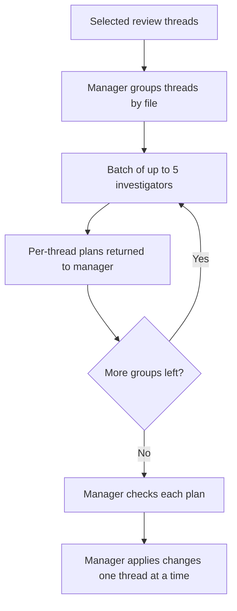
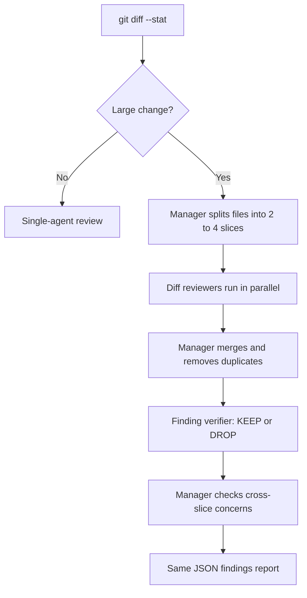

# Teaching Mega Desk to Delegate: Manager and Subagent Runs

Mega Desk runs coding agents against the work my team actually delivers: work items, pull-request reviews, and review comments. Until recently, every run was a single agent doing everything itself. It read the context, investigated the code, made the changes, and reported back.

That works well for small tasks. It starts to strain when the task is large. A PR with 21 open review threads, or a review of a diff that touches dozens of files, asks one agent to hold a lot of unrelated context at once.

So I asked a question I'd ask about any team: where could this work be split up, and who should be responsible for what?

## One setting, three flows

The result is a single setting, **Use subagents for larger tasks**, that applies to three flows: resolving PR comments, work-item implementation runs, and PR reviews. When it's on and the task is big enough, the main agent becomes a manager. It plans the work, hands focused pieces to subagents, and assembles the result.

When the task is small, nothing changes. The manager pattern has overhead, and a three-file change doesn't need a team.

A few boundaries apply. The flow only runs with Claude as the provider, since it depends on the Claude Agent SDK's subagent support. Codex runs ignore the setting. The single-thread "Implement solution" action on an analysis run also stays a single agent.

## Resolving review comments

Comment resolution switches to the subagent flow when a run includes three or more threads.

The investigators are read-only. Each one looks into its threads and returns a plan for each, keyed by thread id. They don't touch files.

The manager is the only agent that edits. It checks each plan, then applies changes one thread at a time.

That rule matters more than the parallelism. Review comments often overlap: two reviewers point at the same method, or a fix for one thread changes the code another thread is about. If several agents edited the same files in parallel, I'd be creating merge conflicts inside a single run. With one writer, overlapping fixes are visible before any edits happen, and the order of changes is deliberate.

## The fan-out I almost ran

My first version told the manager to launch one investigator per thread, all in a single turn.

That sounded reasonable until I went to use it on a PR with 21 comments. That would have meant 21 parallel subagents, which risks rate limits and 21 separate sets of file reads at the same moment. I hadn't tested anything above a few threads. A 21-thread run was exactly where an uncapped fan-out was most likely to go wrong.

I added two limits before running it:

- **Group by file.** Threads that touch the same file go to one investigator, and general comments get their own group. A shared file is read once instead of once per thread.
- **Cap the batch.** The manager launches at most five investigators at a time and waits for that batch to report before starting the next.

If the comments cluster in a handful of files, that's far fewer than 21 investigators. Grouping also gives each investigator the related threads together, which is the context it needs to notice when two comments conflict.

With the limits in place, I ran it on the 21-thread PR. The run took 61 turns, about 18 minutes, and cost $4.16. The log showed the investigators launching in batches and running in parallel, which is what the cap was supposed to produce.

That PR was a proof of concept with more than 1,000 lines of product code, and most of the 21 comments were valid. The manager wasn't just answering questions or dismissing nitpicks. It had to make real edits for most of them. Eighteen minutes felt short for the amount of work I watched it do.

I'm careful not to treat that run as a benchmark in either direction. It was an unusually heavy batch, so comparing its cost to a lighter run would make the subagent flow look worse than it is, and dividing it per thread to compare against a single-thread run doesn't account for how much harder these threads were. A single-thread resolve on another PR took 7 turns and cost $0.25, but those two runs aren't measuring the same kind of work.

What the run does tell me is that a large, heavy resolve with batched subagents launches the way it was designed to, finishes in reasonable time, and costs an amount I'm comfortable repeating while I collect fairer comparisons.

The general lesson is an old one: parallelism needs a limit and a reason for each worker. "One agent per item" is easy to write in a prompt. It isn't automatically a good plan.

## Reviewing large pull requests

PR review uses the same setting, with a size check first. The agent runs `git diff --stat` at the start. If the change is under about 600 lines across fewer than 12 files, it reviews alone, exactly as before. The agent makes that decision at run time, so the check doesn't need an extra Azure DevOps request.

For larger diffs, the manager splits the work:

**Slices keep code with its tests.** The manager groups files by area, and each source file stays in the same slice as its tests. A reviewer looking at a change without its tests is reviewing half the story.

**Reviewers find candidates, not conclusions.** Each diff reviewer is read-only, runs on Sonnet, and receives its file list, a diff command limited to those files, and the work-item context. It returns candidate findings and a two-line summary of its slice.

**A verifier checks the findings.** After the manager merges candidates and removes duplicates, one verifier re-checks each finding against the code, its callers, and its tests. It answers KEEP or DROP with evidence. It can lower a severity, but it can never raise one. Only KEEP findings reach the report.

I care about that verifier step. A review full of false positives trains people to skim it, and a skimmed review isn't worth much. Splitting a review across several agents makes noise more likely, because each reviewer sees only part of the change. The verifier is there to push back on that.

**The manager owns what no slice can see.** Whether the work item's requirements are met overall, and whether tests cover the changed behavior, aren't questions any single slice can answer. The manager checks those itself.

The final output is the same JSON findings block as before, so the review display and the "post review comment" action didn't need to change.

## What I haven't established yet

At the time I'm writing this, I have one real run: the 21-thread comment resolution above. I haven't run a subagent PR review yet, so the size cutoff, the slicing, and the verifier are untested. That run was heavy enough that it doesn't compare cleanly to anything else I have, so I can't yet claim the subagent flow saves money or turns.

Some limits I already know about:

**Cost may go up, not down.** Each slice reviewer re-reads its code, and the verifier re-reads the code behind every cited finding. For PR review in particular, I expect the total cost to be higher. The goal there is quality and speed on large diffs, not savings.

**Read-only is an instruction, not a sandbox.** The reviewers and investigators have shell access so they can use Git. "Don't modify anything" is a rule in their prompt, not a technical block. That's consistent with how the rest of Mega Desk treats analysis runs, but it's worth saying plainly.

**Single-commit reviews fan out too.** The "review a single commit" scope uses the same logic, so one very large commit will also be split up.

## How I'll decide whether to keep it

Because all three flows share one setting, I can run the same PR with it on and off and compare. Mega Desk already shows the cost and turn count in each run's header, and the run log shows subagent activity: lines for each subagent, marked with a bot icon, with their file reads and searches indented underneath.

That gives me something concrete to look at:

- Does a batched comment run cost less, or take fewer turns, than a single agent handling the same number of threads? The fair test is two runs on similar PRs, with similar numbers of comments that need real changes, one with the setting on and one with it off.
- Do subagent reviews surface real issues the single-agent review missed, or mostly more noise?
- Does the verifier actually drop findings, or does it approve almost everything?

I won't claim an improvement until those comparisons exist. It's possible one of the three flows turns out not to be worth its overhead, and that would be a useful result too.

## The part that stays the same

When I built Mega Desk, the point was to keep a deliberate human review step between agent output and what gets accepted. Adding subagents doesn't change that. It adds a layer of delegation inside the run, and the same idea applies there.

The subagents investigate and propose. The manager decides and is the only one that writes. And after the run finishes, I still review the changes before anything is pushed.

Delegation is useful when each worker has a clear piece of the job and someone is responsible for the whole. That's true whether the workers are people or agents.
