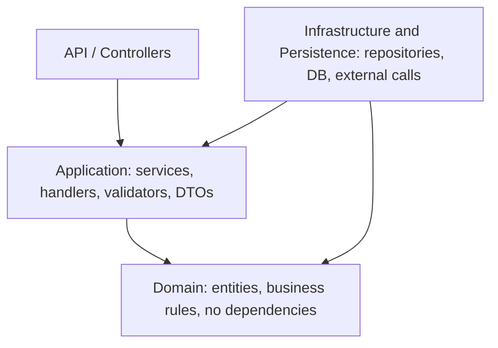

# Architecture Standards

These are the standards I use to structure and review code. They exist so that review feedback is consistent, explainable, and easy to act on. When a rule is linked in a review comment, the goal is to share the reasoning, not to dictate a fix.

The examples are in C# and ASP.NET Core, which is where most of my backend work happens, but the thinking behind most of the rules carries across languages.

## How to use this page

**As an author:** read the rule a reviewer linked, then either apply it or reply with why it doesn't fit. Unusual cases are fine as long as they are deliberate and, where it matters, documented in code or a ticket.

**As a reviewer:** link the rule ID in your comment and mark how strongly it applies.

> **[Should] ARCH-01** – This controller validates the request and maps the result. See [ARCH-01](#arch-01-controllers-only-route).

### Severity levels

| Level | Meaning | Effect on the PR |
|---|---|---|
| **Must** | Correctness, security, or a layer violation in new code | Resolve before approval |
| **Should** | The expected standard for new code | Fix in this PR, or defer with a ticket if the reviewer agrees |
| **Consider** | A suggestion or a direction for future work | Non-blocking |

Each rule lists a **default** severity. A reviewer may raise or lower it with a reason. Existing code that already breaks a rule is not a reason to repeat it, and it does not have to be fixed in an unrelated PR.

### Linking to a rule

Heading anchors are generated from the heading text, so a rule links as `#arch-01-controllers-only-route`. Rule IDs are stable, so links in old review comments keep working.

## Rule index

**Architecture**

| Rule | Summary | Default |
|---|---|---|
| [ARCH-01](#arch-01-controllers-only-route) | Controllers only route | Must |
| [ARCH-02](#arch-02-rely-on-framework-defaults) | Rely on framework defaults | Should |
| [ARCH-03](#arch-03-validate-upstream-trust-downstream) | Validate upstream, trust downstream | Must |
| [ARCH-04](#arch-04-business-logic-lives-on-domain-objects) | Business logic lives on domain objects | Should |
| [ARCH-05](#arch-05-do-not-expose-domain-or-ef-entities-across-boundaries) | Do not expose domain or EF entities across boundaries | Must |
| [ARCH-06](#arch-06-respect-layer-dependency-direction) | Respect layer dependency direction | Must |
| [ARCH-07](#arch-07-repositories-fetch-and-write-they-do-not-decide) | Repositories fetch and write; they do not decide | Should |
| [ARCH-08](#arch-08-services-do-not-depend-on-other-services) | Services do not depend on other services | Should |
| [ARCH-09](#arch-09-keep-new-slices-scoped) | Keep new slices scoped | Consider |

**Error handling**

| Rule | Summary | Default |
|---|---|---|
| [ERR-01](#err-01-fail-loudly) | Fail loudly | Must |
| [ERR-02](#err-02-do-not-use-trycatch-as-flow-control) | Do not use try/catch as flow control | Should |
| [ERR-03](#err-03-use-the-result-pattern-only-where-the-backend-must-branch) | Use the Result pattern only where the backend must branch | Should |
| [ERR-04](#err-04-never-send-exception-details-to-clients) | Never send exception details to clients | Must |

**Types and contracts**

| Rule | Summary | Default |
|---|---|---|
| [TYPE-01](#type-01-use-enums-not-strings-or-magic-values) | Use enums, not strings or magic values | Should |
| [TYPE-02](#type-02-avoid-ambiguous-nullability) | Avoid ambiguous nullability | Should |
| [TYPE-03](#type-03-contracts-must-carry-intent) | Contracts must carry intent | Should |
| [TYPE-04](#type-04-follow-the-teams-language-conventions) | Follow the team's language conventions | Consider |

**Code design and readability**

| Rule | Summary | Default |
|---|---|---|
| [CODE-01](#code-01-small-single-purpose-methods) | Small, single-purpose methods | Should |
| [CODE-02](#code-02-the-caller-decides) | The caller decides | Should |
| [CODE-03](#code-03-make-intent-visible) | Make intent visible | Should |
| [CODE-04](#code-04-remove-duplication-deliberately) | Remove duplication deliberately | Should |
| [CODE-05](#code-05-prefer-testable-seams-over-statics) | Prefer testable seams over statics | Should |

**Security**

| Rule | Summary | Default |
|---|---|---|
| [SEC-01](#sec-01-never-trust-client-supplied-identity) | Never trust client-supplied identity | Must |
| [SEC-02](#sec-02-secure-by-default) | Secure by default | Must |
| [SEC-03](#sec-03-verify-against-stored-state) | Verify against stored state | Must |
| [SEC-04](#sec-04-keep-secrets-out-of-source-and-out-of-sight) | Keep secrets out of source and out of sight | Must |

**Database**

| Rule | Summary | Default |
|---|---|---|
| [DB-01](#db-01-audit-columns-and-timestamps) | Audit columns and timestamps | Should |
| [DB-02](#db-02-clear-consistent-names) | Clear, consistent names | Should |
| [DB-03](#db-03-choose-the-lightest-structure) | Choose the lightest structure | Consider |
| [DB-04](#db-04-put-scripts-in-the-right-category) | Put scripts in the right category | Must |
| [DB-05](#db-05-bound-the-work) | Bound the work | Consider |

**Frontend**

| Rule | Summary | Default |
|---|---|---|
| [FE-01](#fe-01-keep-components-presentational-and-small) | Keep components presentational and small | Should |
| [FE-02](#fe-02-no-backend-logic-in-the-ui) | No backend logic in the UI | Must for new code |
| [FE-03](#fe-03-hooks-fail-loudly-and-trust-their-own-data) | Hooks fail loudly and trust their own data | Should |
| [FE-04](#fe-04-use-a-form-validation-library) | Use a form validation library | Consider |
| [FE-05](#fe-05-keep-types-honest) | Keep types honest | Should |

**Testing**

| Rule | Summary | Default |
|---|---|---|
| [TEST-01](#test-01-a-test-must-be-able-to-fail) | A test must be able to fail | Should |
| [TEST-02](#test-02-keep-tests-deterministic-and-decoupled) | Keep tests deterministic and decoupled | Should |
| [TEST-03](#test-03-parameterize-repeated-cases) | Parameterize repeated cases | Consider |

**Process**

| Rule | Summary | Default |
|---|---|---|
| [PROC-01](#proc-01-branch-directly-off-develop) | Branch directly off `develop` | Consider |
| [PROC-02](#proc-02-keep-prs-focused) | Keep PRs focused | Should |
| [PROC-03](#proc-03-defer-deliberately) | Defer deliberately | Consider |

---

## Layers and dependencies

Dependencies point inward. Outer layers know about inner layers, never the reverse.



| Layer | Owns | Does not own |
|---|---|---|
| **Controllers** | Routing, HTTP status codes, auth attributes | Validation, mapping, business logic, file generation |
| **Application** | Use cases, orchestration, DTOs, request validation, entity-to-DTO mapping | Persistence details, HTTP concerns |
| **Domain** | Business rules and behavior on entities, domain exceptions | Dependencies on other layers, DTOs, DB parameters |
| **Infrastructure** | Repositories, stored procedure access, external services | Business decisions, sorting policy, response shaping |

---

## Architecture

### ARCH-01: Controllers only route
**Default: Must**

A controller accepts a request, calls one application service or handler, and returns the result. It does not validate input, compare IDs, branch on failure results, build files or byte arrays, hold constants, or decide what to do when something is missing.

**Why:** Logic in a controller cannot be reused or unit tested without HTTP, and it spreads business decisions across layers.

```csharp
// Do
[HttpPut("{id}")]
public async Task<IActionResult> Update(int id, UpdateComponentRequest request)
    => Ok(await _componentService.UpdateAsync(id, request));
```

### ARCH-02: Rely on framework defaults
**Default: Should**

Do not add attributes or return types the framework already provides.

- `[ApiController]` already performs model-state validation and binds complex types from the body and primitives from the query string. Drop redundant `[FromBody]`, `[FromQuery]`, and manual `ModelState` checks.
- Use `ActionResult<T>` only when the endpoint returns more than one status code.
- Use primary constructors for dependency injection where the language version supports them.
- Do not null-check injected dependencies. Container construction fails on missing registrations.

### ARCH-03: Validate upstream, trust downstream
**Default: Must**

Validate input shape (required, range, format, non-empty) at the boundary using data annotations, a validator, or a validation pipeline. Validate business rules inside the domain. Services and handlers can then assume valid input and should not repeat null, empty, or whitespace checks.

**Why:** Scattered validation hides which rules actually exist and invites inconsistent behavior. Defensive checks in services often cover for bad data that should be fixed at its source.

### ARCH-04: Business logic lives on domain objects
**Default: Should**

Put behavior next to the data it operates on, for example `component.ChangeDescription(...)`, and let the repository persist the updated aggregate. Avoid static "helper", "calculator", or "engine" classes that accumulate unrelated logic. Keep logic close to the type it concerns.

**Why:** Self-contained domain objects are easier to reason about, test, and change than logic spread across helpers.

### ARCH-05: Do not expose domain or EF entities across boundaries
**Default: Must**

Map entities to DTOs in the application layer. Never return entities from a service or controller. Do not configure serializers to ignore reference cycles (`ReferenceHandler.IgnoreCycles`) to make entity serialization work. Fix the cause by returning DTOs.

**Why:** Returning entities leaks data to clients, produces unpredictable payload sizes, and couples the database shape to the API.

### ARCH-06: Respect layer dependency direction
**Default: Must**

- The domain layer has no dependencies and contains only business logic.
- DTOs, requests, responses, and paged results live in the application layer, not the domain layer.
- Database parameters and infrastructure types do not appear in domain models or inputs.
- Calls to stored procedures belong behind a generic infrastructure API, not scattered through application or domain classes.

### ARCH-07: Repositories fetch and write; they do not decide
**Default: Should**

- Repository methods return domain entities. Mapping to DTOs happens in the application layer.
- Leave sorting and filtering policy to the caller, who knows what it needs.
- A class whose methods are all read-only projections is a query service, not a repository.
- Access child entities through their parent aggregate unless they have an independent lifecycle.
- Use `Create` for a new aggregate and `Add` for attaching a child to a parent.
- Return a purpose-built type instead of a tuple. A tuple can only grow by breaking every caller.

### ARCH-08: Services do not depend on other services
**Default: Should**

Depend on a repository, or let the caller orchestrate. Service-to-service calls create hidden workflows, tight coupling, and implicit dependencies.

### ARCH-09: Keep new slices scoped
**Default: Consider**

When a new backend slice starts pulling in many tables or logic owned by an existing system, stop and decide where the feature belongs. Prefer a clear contract between systems over duplicating the other system's responsibilities.

---

## Error handling

### ERR-01: Fail loudly
**Default: Must**

When something unexpected happens, throw. A global exception handler logs it (for example to Sentry) and returns a standard problem response. Do not catch an error and return an empty result, an empty list, or a default value. Guard clauses should throw instead of quietly continuing. For a missing entity, throw a not-found exception and let the global handler translate it.

**Why:** Swallowed failures turn bugs into mysteries. A loud failure is logged once, in one place, and fixed.

### ERR-02: Do not use try/catch as flow control
**Default: Should**

Catch an exception only to handle a specific, recoverable condition. Do not use it to choose between code paths, for example "try the new path, catch and fall back to the old one." Make the alternatives explicit methods and let the caller decide.

### ERR-03: Use the Result pattern only where the backend must branch
**Default: Should**

Use a result object when a method has expected, distinguishable outcomes that the calling code must handle, such as a primary path with a fallback. Do not return result objects up to controllers only to translate them into status codes, and do not send them to the frontend. In those cases throw a domain or use-case exception and let the global handler respond.

```csharp
// Do: explicit paths, no hidden branching
var result = await _search.SearchV6Async(query);
if (result.IsFailure)
    result = await _search.SearchLegacyAsync(query);
```

### ERR-04: Never send exception details to clients
**Default: Must**

Exception messages, stack traces, and exception types are not part of any API response. They help attackers and they leak implementation details. Return a standard problem response and log the details server-side.

---

## Types and contracts

### TYPE-01: Use enums, not strings or magic values
**Default: Should**

Represent state, modes, sort fields, and flags with enums. Do not use single-character codes, magic strings, or free-form sort expressions. If the database needs a string, convert at the data boundary.

**Why:** Enums are self-documenting, validated by the compiler, and constrain what callers can send. Sort enums can also be stacked and validated easily.

### TYPE-02: Avoid ambiguous nullability
**Default: Should**

- Make a value nullable only when null has a defined, documented meaning.
- Collections default to empty, never null. Strings default to empty where an empty value is acceptable.
- Do not model three states with a nullable bool. Use an enum.
- A nullable numeric field in a DTO needs a reason. If the "no value" state matters, make it explicit with a purpose-built type.
- Remove redundant `?? null`, null-forgiving `!`, and checks that normalize data you own.

**Why:** Nullable collections and values spread repetitive null checks through the codebase and hide what a missing value means.

### TYPE-03: Contracts must carry intent
**Default: Should**

A response must let the client distinguish "not requested" from "requested and empty." The backend contract serves the frontend's needs. If the frontend has to parse, infer, or reassemble data to compensate, fix the contract.

### TYPE-04: Follow the team's language conventions
**Default: Consider**

- Use records (with primary constructors) for DTOs and `sealed` for classes not designed for inheritance.
- Use `Async` suffixes, always `await` async calls, and pass cancellation tokens where the call supports them.
- Use `ILogger<T>` with the enclosing type, keyword type names (`string.IsNullOrEmpty`), and `Id` rather than `ID` in names.
- Move repeated `using` directives to global usings.
- Configure brace style and formatting in `.editorconfig` so it is enforced by tooling, not review.

---

## Code design and readability

### CODE-01: Small, single-purpose methods
**Default: Should**

A method does one job. Use early exits to reduce nesting, split distinct paths into separate methods, and move unrelated work out. If describing what a method does needs "and," split it.

### CODE-02: The caller decides
**Default: Should**

Do not hide a decision inside a method with a silent short-circuit or a boolean flag that selects behavior. Put the check in the caller so it is clear whether an action happened, or split the method into two with clear names.

### CODE-03: Make intent visible
**Default: Should**

- Give complex conditions named variables.
- Avoid large nested ternaries and nested loops. Use `Where` and `Select`, or extract helpers, when it makes intent clearer.
- Use constants instead of repeated literals.
- Name methods for what they do. Avoid vague verbs such as "Handle."
- Comments explain why, not what.

### CODE-04: Remove duplication deliberately
**Default: Should**

Consolidate identical branches and getters into one reusable expression. Duplication kept on purpose, such as preserving old behavior behind a feature toggle, is acceptable when it is commented and has a ticket to remove it.

### CODE-05: Prefer testable seams over statics
**Default: Should**

Static classes that hold domain logic or perform I/O cannot be mocked, replaced, or verified, and they tie every caller to one implementation. Pure, stateless helpers are fine. When logic needs behavior, move it to a domain object or inject it.

---

## Security

### SEC-01: Never trust client-supplied identity
**Default: Must**

User identity, roles, and ownership come from authenticated claims, not request bodies or parameters. Anything the client sends can be altered.

### SEC-02: Secure by default
**Default: Must**

Apply `[Authorize]` at the controller class level so every endpoint is protected by default. Opt out explicitly and only where required.

### SEC-03: Verify against stored state
**Default: Must**

Compare client input with the entity loaded through the application and repository layers, never only with other values from the same request. For example, checking that a route ID equals an ID in the body proves nothing about what the caller is allowed to change.

### SEC-04: Keep secrets out of source and out of sight
**Default: Must**

Secrets, connection strings, and live keys stay in the secret store and on the servers that need them. They do not belong in PR descriptions, local configuration, repositories, or command-line arguments, where process listings can expose them.

---

## Database

### DB-01: Audit columns and timestamps
**Default: Should**

New tables include `CreatedAt` and `UpdatedAt` defaulting to the current UTC time, so the application does not set them or handle nulls. Record who made changes with `CreatedByUserId` and `UpdatedByUserId`, and store the username as well, since usernames can change.

### DB-02: Clear, consistent names
**Default: Should**

Name foreign keys to match what they reference (for example `WorkflowRuleId`). Name parent and child tables for what they are. Use enums instead of cryptic single-character indicators, translating at the boundary if a legacy system needs the old value.

### DB-03: Choose the lightest structure
**Default: Consider**

If a set of values is fixed in code, use an enum or constrained column rather than a lookup table. Remove columns that nothing uses, and question columns that imply behavior the application does not have.

### DB-04: Put scripts in the right category
**Default: Must**

Re-runnable objects such as stored procedures go in the "Always" category. One-time changes go in "Once." The wrong category causes missed updates or repeated runs.

### DB-05: Bound the work
**Default: Consider**

Queries that load all rows for a parent should have a date or count limit unless the set is known to be small. Pass cancellation tokens to repository calls.

---

## Frontend

### FE-01: Keep components presentational and small
**Default: Should**

Components render and delegate. Move non-presentation logic to hooks, utilities, or services. Split large pages and dialogs into smaller components. A file that has grown past roughly a thousand lines is a signal to refactor.

### FE-02: No backend logic in the UI
**Default: Must for new code**

Do not implement backend concerns in the frontend, such as parsing a backend expression language, validating business rules, or reproducing server calculations. If the backend contract does not fit what the UI needs, change the contract. Duplicated backend logic couples the two sides tightly.

### FE-03: Hooks fail loudly and trust their own data
**Default: Should**

Do not swallow errors and return empty arrays. Do not normalize data your own code wrote, for example storage entries. Parse it, type it, and let TypeScript catch shape errors before the write.

### FE-04: Use a form validation library
**Default: Consider**

Adopt a standard form validation library (for example Formik with Yup, or an equivalent) instead of hand-written validation in each form.

### FE-05: Keep types honest
**Default: Should**

Remove non-null assertions (`!`) by making argument types accurate, and default values to sane empties instead of `null` or `undefined` where the UI would otherwise need repeated checks.

---

## Testing

### TEST-01: A test must be able to fail
**Default: Should**

Assertions must break when the behavior they cover breaks. Watch for mocks that always return success or "triggered," assertions that only check part of the outcome (for example the description but not the evaluated rule), and fixtures that cannot distinguish the right result from a wrong one.

### TEST-02: Keep tests deterministic and decoupled
**Default: Should**

Do not use random values, current time, or framework-specific formatting in assertions. A failing test should be reproducible. Assert the meaning, not the exact string a library happens to produce.

### TEST-03: Parameterize repeated cases
**Default: Consider**

Combine near-identical tests with data-driven tests (for example `MemberData`) so each case is one row, not one method.

---

## Process

### PROC-01: Branch directly off `develop`
**Default: Consider**

Create a branch in the shared repository off `develop` and open the PR back to `develop`. Personal forks or separate repositories add overhead and make collaboration harder.

### PROC-02: Keep PRs focused
**Default: Should**

One PR, one responsibility. Split unrelated changes so each can be reviewed and rolled back independently. Release merges are the usual exception.

### PROC-03: Defer deliberately
**Default: Consider**

Non-blocking improvements can be captured in a follow-up (tech-debt or software quality) ticket. Link the ticket in the thread, say that it does not block the PR, and resolve the thread with a note. Deferral works only if the ticket gets done.

---

## Suggested comment templates

> **[Must] SEC-01** – This takes the user ID from the request body. It should come from the authenticated claims so it cannot be altered by the caller. See [SEC-01](#sec-01-never-trust-client-supplied-identity).

> **[Should] CODE-02** – This method silently returns when the flag is off, so the caller cannot tell whether the work ran. Consider moving the check to the caller. See [CODE-02](#code-02-the-caller-decides).

> **[Consider] TYPE-02** – Does `null` mean something different from an empty list here? If not, default to empty and drop the null checks downstream. See [TYPE-02](#type-02-avoid-ambiguous-nullability). Not blocking this PR.

## Maintaining these standards

- Discuss before changing a **Must** rule.
- Do not renumber or rename rule IDs. Heading text forms the anchor, so renaming a heading breaks links in existing review comments. If a rule is retired, mark it "Retired" and keep the heading.
- Add new rules at the end of their section with the next number.
